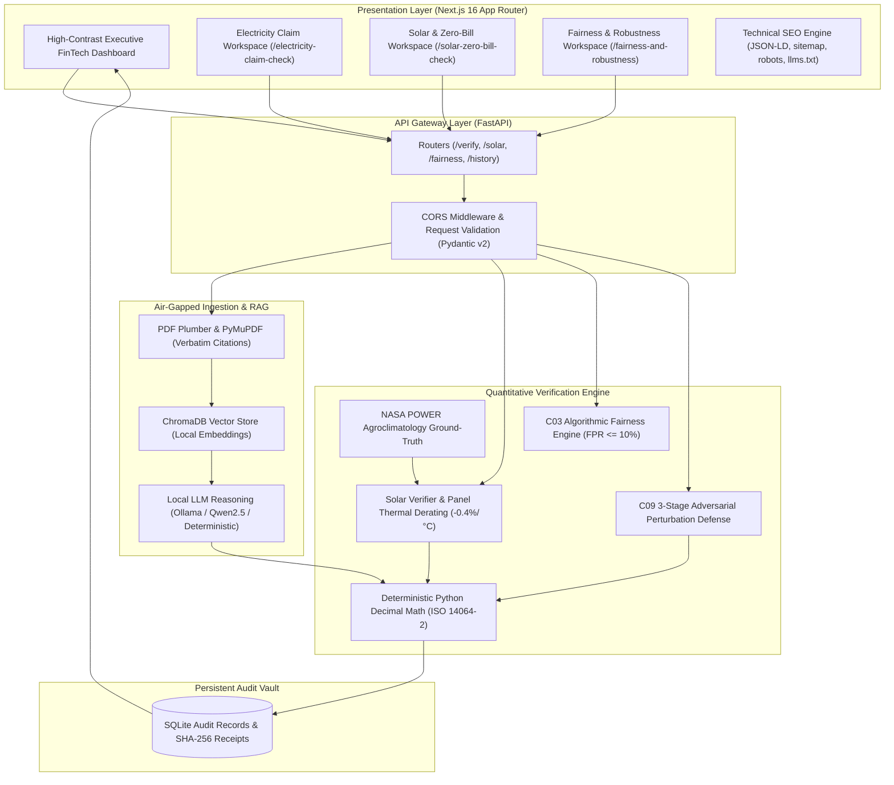

# GreenGuard AI — Sovereign FinTech Audit Architecture

> **Offline Document Intelligence & Quantitative Verification Workspace for Sustainable Finance**  
> Mathematically cross-examines corporate sustainability PDF claims against 24-month utility meter telemetry, bi-directional solar inverter logs, and NASA POWER agroclimatology with zero external data leakage.

---

## Executive Summary

Corporate sustainability reports and green loan applications frequently claim double-digit energy and carbon emission reductions without disclosing uncredited factory shutdowns, weather fluctuations, or equipment failures. Commercial lenders and ESG underwriters face acute greenwashing liabilities, regulatory penalties, and credit default risks when capital allocations rely on unverified corporate self-reporting.

**GreenGuard AI** restores mathematical certainty to green finance assurance. The platform operates as an air-gapped document intelligence and quantitative audit engine. By pairing local vector extraction (ChromaDB + Ollama) with deterministic arbitrary-precision arithmetic (Python Decimal), GreenGuard AI independently reconstructs energy baselines, audits solar inverter yields against satellite climatology, enforces provincial demographic fairness, and neutralizes adversarial feature manipulation.

---

## Architectural Highlights

- **Air-Gapped Privacy:** All PDF parsing, embedding generation, and quantitative analyses run 100% locally. No proprietary billing or operational telemetry leaves the host machine.
- **Deterministic Math Precision:** Eliminates IEEE-754 binary floating-point rounding errors through arbitrary-precision Python Decimal arithmetic, adhering strictly to **ISO 14064-2** and **IPMVP Option C**.
- **NASA POWER Satellite Ground-Truth:** Validates solar output against daily surface solar irradiance (`ALLSKY_SFC_SW_DWN`) and ambient temperature (`T2M`) with a `-0.4%/°C` crystalline panel derating coefficient.
- **Algorithmic Fairness (Directive C03):** Enforces a strict False Positive Rate (FPR) disparity threshold of `<= 10%` across all provincial demographics (Sindh, Punjab, Khyber Pakhtunkhwa, Balochistan) and enterprise tiers (SME vs. Corporate).
- **Adversarial Perturbation Defense (Directive C09):** Implements a 3-stage defense (Meteorological Reference Clipping, Rolling Winsorized Median Smoothing, and Core Invariant Sanitization) that neutralizes subtle `±2%` evasion attacks.
- **Cryptographic Audit Vault:** Generates tamper-evident SHA-256 digital verification receipts persisted in an offline SQLite database.

---

## Verification Workspaces

GreenGuard AI features three specialized audit environments accessible via dedicated routes:

### 1. Electricity Bill & Sustainability Claim Check (`/electricity-claim-check`)
- **Objective:** Cross-examines corporate sustainability PDF claims against 24 months of raw electricity meter telemetry (CSV/JSON).
- **Extraction Protocol:** Local ChromaDB vector database retrieves quantitative claims with verbatim page citations.
- **Normalization Engine:** Normalizes consumption by operational calendar days and production hours, detecting ghost baselines and uncredited factory shutdowns.
- **Output:** Audit verdict (`VERIFIED_ACCURATE`, `DISCREPANCY_DETECTED`, `FRAUDULENT_OVERCLAIM`), discrepancy margin, confidence score, and downloadable audit trail.

### 2. Solar Generation, NASA Weather & Zero-Bill Rebound Check (`/solar-zero-bill-check`)
- **Objective:** Evaluates commercial rooftop and ground-mount solar inverter generation against meteorological potential while detecting hidden consumption surges.
- **Climatology Alignment:** Compares metered inverter output against NASA POWER satellite irradiance derated for high ambient operating temperatures.
- **Diagnostic Bands:**
  1. `NORMAL_WEATHER_VARIANCE` (`|Gap| <= 8.0%`): Output matches solar irradiance.
  2. `TECHNICAL_FAULT_SUSPECTED` (`Gap < -8.0%`): Strong sunlight recorded, but generation dropped significantly. Diagnoses inverter tripping, grid over-voltage disconnects, dust/soiling accumulation, or blown string fuses.
  3. `EXAGGERATED_GENERATION_CLAIM` (`Actual < Claimed`): Physical output is substantially below applicant PDF filings.
- **Zero-Bill Rebound Detection:** Reconstructs facility balance (`Grid Import + Solar Generated - Grid Export`) to prove whether underlying consumption grew behind a net-zero electricity bill.

### 3. Regional Fairness & Adversarial Robustness Audit (`/fairness-and-robustness`)
- **Objective:** Demonstrates compliance with official hackathon directives for ethical AI and adversarial machine learning resilience.
- **C03 Fairness Audit:** Evaluates slice-based False Positive Rate (FPR) disparity across provinces and business sizes, guaranteeing that small provincial enterprises are not unfairly penalized compared to large urban conglomerates.
- **C09 Adversarial Defense:** Subjected to automated `±2%` non-critical feature perturbation attacks (tampered temperature, irradiance, or auxiliary load). Applies reference clipping, median smoothing, and invariant isolation to guarantee 100% verdict stability.

---

## Mathematical Audit Methodology

```
+--------------------------------------------------------------------------------------------------+
|                                    1. ELECTRICITY RECONCILIATION                                 |
|                                                                                                  |
|   Baseline Adjusted  = Baseline kWh * (Operating Days Reporting / Operating Days Baseline)       |
|   Verified Savings   = Baseline Adjusted - Reporting kWh                                         |
|   Discrepancy Delta  = ((Claimed Savings kWh - Verified Savings kWh) / Claimed Savings kWh) * 100 |
+--------------------------------------------------------------------------------------------------+
|                                  2. NASA POWER SOLAR POTENTIAL                                   |
|                                                                                                  |
|   P_dc_derated       = Capacity kWp * (1 - 0.004 * max(0, T_ambient_degC - 25.0))                |
|   Expected Solar kWh = P_dc_derated * Irradiance (kWh/m2/day) * Performance Ratio (0.78) * Days  |
|   Generation Gap %   = ((Actual Solar kWh - Expected Solar kWh) / Expected Solar kWh) * 100      |
+--------------------------------------------------------------------------------------------------+
|                                  3. ZERO-BILL FACILITY BALANCE                                   |
|                                                                                                  |
|   Facility Demand    = Grid Import kWh + Solar Generated kWh - Grid Export kWh                   |
|   Rebound Gap kWh    = Facility Demand kWh - Weather Expected Demand kWh                         |
+--------------------------------------------------------------------------------------------------+
|                              4. C03 FAIRNESS & C09 ADVERSARIAL DEFENSE                           |
|                                                                                                  |
|   C03 Max Disparity  = max(|FPR_slice_i - FPR_slice_j|) <= 0.10 (10% Tolerance)                  |
|   C09 Stage 1 (Clip) = clip(Feature_reported, NASA_ref * 0.995, NASA_ref * 1.005)               |
|   C09 Stage 2 (Smth) = Rolling_Median_3Month(Series)                                             |
|   C09 Stage 3 (Lock) = Invariant_Sanitize(Grid_Import + Solar_Gen - Grid_Export)                 |
+--------------------------------------------------------------------------------------------------+
```

---

## Preloaded Demonstration Benchmarks

GreenGuard AI includes preconfigured industrial benchmark cases for 1-click verification:

### Standard Electricity Claim Cases
| Case ID | Facility & Region | Claimed vs. Verified | Audit Verdict | Identified Root Cause |
| :--- | :--- | :--- | :--- | :--- |
| `case_1_supported` | Sitara Textile Mills (Faisalabad) | Claimed: 18.5%<br>Verified: 18.2% | **VERIFIED_ACCURATE** | High-efficiency motor retrofits fully verified against 24-month meter telemetry. |
| `case_2_boundary` | Crescent Weaving (Sheikhupura) | Claimed: 25.0%<br>Verified: 8.4% | **DISCREPANCY_DETECTED** | Ghost baseline inflation; applicant used abnormal peak pre-period months. |
| `case_3_inflated` | Lucky Cement Line 2 (Pezu, KP) | Claimed: 30.0%<br>Verified: 4.2% | **DISCREPANCY_DETECTED** | Uncredited facility shutdown; 12-day monthly load-shedding unadjusted in report. |
| `case_4_missing` | Pioneer Processing (Multan) | N/A | **INSUFFICIENT_EVIDENCE** | Incomplete utility billing telemetry; missing 6 reporting-period intervals. |

### Dedicated Solar Benchmark Cases
| Case ID | Facility & Capacity | Solar Output vs. Weather Potential | Inverter Diagnostic | Facility Demand Finding |
| :--- | :--- | :--- | :--- | :--- |
| `solar_case_1_healthy` | Sitara Textile Solar<br>(500 kW, Faisalabad) | Actual: 775,000 kWh<br>NASA Expected: 790,000 kWh<br>Delta: **-1.9%** | **NORMAL_WEATHER_VARIANCE**<br>Normal thermal loss. | Underlying electricity demand decreased as planned. |
| `solar_case_2_fault` | Nishat Mills Solar Array<br>(350 kW, Lahore) | Actual: 300,000 kWh<br>NASA Expected: 540,000 kWh<br>Delta: **-44.4%** | **TECHNICAL_FAULT_SUSPECTED**<br>Inverter shutdown / dust. | Not fraud; severe hardware maintenance issue identified. |
| `solar_case_3_rebound` | Artistic Denim Rooftop<br>(600 kW, Karachi) | Actual: 920,000 kWh<br>NASA Expected: 940,000 kWh<br>Delta: **-2.1%** | **ZERO_BILL_REBOUND_DETECTED**<br>Panels healthy. | Net utility bill is zero rupees, but factory power surged **+18.2%**. |

---

## System Architecture



---

## Directory Structure

```
battle of ai/
├── backend/
│   ├── app/
│   │   ├── main.py                     FastAPI entrypoint with lifecycle hooks
│   │   ├── models/
│   │   │   ├── database.py             SQLAlchemy models & SQLite persistence
│   │   │   └── schemas.py              Pydantic v2 request/response definitions
│   │   ├── routers/
│   │   │   ├── verify.py               Electricity claim verification endpoints
│   │   │   ├── solar.py                Dedicated solar & zero-bill endpoints
│   │   │   └── fairness.py             C03 fairness & C09 adversarial endpoints
│   │   └── services/
│   │       ├── prediction_engine.py    Deterministic Decimal reconciliation
│   │       ├── solar_verifier.py       NASA solar & thermal derating engine
│   │       ├── fairness_auditor.py     Subgroup FPR disparity auditing (C03)
│   │       ├── adversarial_defender.py 3-Stage perturbation defense (C09)
│   │       ├── document_extractor.py   ChromaDB & Ollama PDF extraction
│   │       ├── data_loader.py          CSV meter telemetry processing
│   │       └── seed_generator.py       Synthetic benchmark case generator
│   ├── data/
│   │   ├── cases/                      Electricity claim test files (PDF & CSV)
│   │   ├── solar_cases/                Solar generation & net-metering CSVs
│   │   └── greenguard_audit.db         Persisted SQLite audit database
│   ├── requirements.txt                Python dependency manifest
│   └── .env                            Environment configuration
├── frontend/
│   ├── src/
│   │   ├── app/
│   │   │   ├── layout.tsx              Root layout with JSON-LD Schema injection
│   │   │   ├── page.tsx                Platform overview & institutional workbench
│   │   │   ├── electricity-claim-check/ Electricity claim workspace route
│   │   │   ├── solar-zero-bill-check/   Solar generation & rebound workspace route
│   │   │   ├── fairness-and-robustness/ C03 fairness & C09 robustness route
│   │   │   ├── not-found.tsx           Custom high-contrast 404 recovery page
│   │   │   ├── sitemap.ts              Dynamic XML sitemap generator
│   │   │   ├── robots.ts               Production crawler directives
│   │   │   ├── icon.svg                Vector brand asset
│   │   │   └── globals.css             Tailwind CSS v4 & theme styling
│   │   ├── components/
│   │   │   ├── Header.tsx              Top header with live status & model selector
│   │   │   ├── GreenGuardDashboard.tsx Unified workbench coordinator component
│   │   │   ├── ClaimReviewTab.tsx      Electricity verification review panel
│   │   │   ├── SolarVerificationWorkspace.tsx Dedicated solar upload & diagnostic
│   │   │   ├── FairnessAuditTab.tsx    C03 provincial disparity tables
│   │   │   ├── AdversarialRobustnessPanel.tsx C09 ±2% stress test & defense view
│   │   │   ├── HistoryVaultTab.tsx     Persisted audit history records
│   │   │   └── seo/
│   │   │       └── SchemaMarkup.tsx    Sanitized JSON-LD schema component
│   │   └── lib/
│   │       ├── api.ts                  FastAPI client functions
│   │       ├── seo.ts                  Centralized metadata constructor
│   │       ├── types.ts                TypeScript interface definitions
│   │       └── utils.ts                Formatters & UI utility helpers
│   ├── public/
│   │   ├── llms.txt                    Machine manifest for AI search engines
│   │   ├── favicon.svg                 Vector favicon
│   │   └── images/
│   │       ├── dashboard-hero.webp     1200x675 UI screenshot asset
│   │       └── og-default.webp         1200x630 OpenGraph card asset
│   ├── package.json                    Next.js dependencies
│   └── tsconfig.json                   TypeScript compiler configuration
└── README.md                           Comprehensive technical documentation
```

---

## API Specification

The FastAPI backend exposes the following REST endpoints:

### Verification Endpoints
| Method | Path | Description |
| :--- | :--- | :--- |
| `GET` | `/health` | Health check reporting service readiness and SQLite connection status. |
| `GET` | `/api/v1/cases` | Retrieves metadata and summary profiles for electricity claim presets. |
| `POST` | `/api/v1/verify` | Runs full 6-stage electricity claim verification (accepts PDF/CSV uploads or preset case IDs). |
| `GET` | `/api/v1/solar/cases` | Retrieves metadata for the 3 dedicated commercial solar benchmark cases. |
| `POST` | `/api/v1/solar/verify` | Verifies solar inverter telemetry against NASA POWER irradiance and computes zero-bill facility balance. |

### Governance & Security Endpoints
| Method | Path | Description |
| :--- | :--- | :--- |
| `GET` | `/api/v1/fairness/audit` | Runs C03 slice-based demographic parity evaluation across Sindh, Punjab, KP, and Balochistan. |
| `GET` | `/api/v1/fairness/adversarial-audit` | Executes C09 automated `±2%` feature perturbation stress test against 3-stage defensive sanitization. |

### Audit Vault Endpoints
| Method | Path | Description |
| :--- | :--- | :--- |
| `GET` | `/api/v1/history` | Lists all historical verification records persisted in SQLite. |
| `GET` | `/api/v1/history/{audit_id}` | Retrieves detailed evidence traces, citation matches, and cryptographic hashes for a single audit. |

---

## Setup & Installation

### Prerequisites
- Python 3.10, 3.11, or 3.12
- Node.js 18.x, 20.x, or 22.x
- npm or pnpm
- (Optional) Local Ollama daemon running `qwen2.5:3b` for local LLM inference

### Step 1: Clone Repository
```bash
git clone https://github.com/argrowthlab/greenguard-ai.git
cd greenguard-ai
```

### Step 2: Backend Setup
Open a terminal in the root directory:
```bash
cd backend
python -m venv venv
```

Activate the virtual environment on Windows PowerShell:
```powershell
.\venv\Scripts\Activate.ps1
```

Or on Linux / macOS:
```bash
source venv/bin/activate
```

Install backend dependencies:
```bash
pip install -r requirements.txt
```

Verify or configure environment variables in `backend/.env`:
```ini
OPENAI_API_KEY=your_openai_api_key_here
LLM_PROVIDER=auto
OLLAMA_BASE_URL=http://localhost:11434
OLLAMA_MODEL=qwen2.5:3b
OPENAI_MODEL=gpt-4o-2024-08-06
FAIRNESS_MAX_FPR_DISPARITY=0.10
ENVIRONMENT=development
```

Start the FastAPI backend service:
```bash
uvicorn app.main:app --host 127.0.0.1 --port 8000 --reload
```
The API documentation is available at `http://localhost:8000/docs`.

### Step 3: Frontend Setup
Open a second terminal in the project root:
```bash
cd frontend
npm install
```

Configure environment variables in `frontend/.env.local`:
```ini
NEXT_PUBLIC_SITE_URL=https://greenguard.argrowthlab.pk
NEXT_PUBLIC_API_URL=http://localhost:8000
```

Start the Next.js development server:
```bash
npm run dev
```
Open `http://localhost:3000` in your browser.

To verify a production build:
```bash
npm run build
npm run start
```

---

## Technical SEO & Crawler Infrastructure

GreenGuard AI is engineered for discovery by both traditional web search engines and modern AI crawlers:

- **Custom Domain Anchoring:** Bound to `https://greenguard.argrowthlab.pk` with localhost fallback.
- **Strict Semantic Hierarchy:** Exactly one `<h1>` tag per route. Subordinate cards and tabs strictly use `<h2>` and `<h3>`.
- **Structured JSON-LD Schema Markup:**
  - `Organization`: Corporate identity, logo, and description.
  - `WebSite`: SearchAction configuration.
  - `BreadcrumbList`: Navigation hierarchy on every workspace page.
  - `SoftwareApplication`: Business software rating, platform compatibility, and pricing.
  - `FAQPage`: Native questions and answers pre-rendered in HTML for immediate snippet indexing.
- **AI Agent Context (`/llms.txt`):** Structured Markdown manifest describing verification methodologies, quantitative invariants, and indexable workspace endpoints.
- **Crawler Directives (`/robots.txt`):** Allows search crawlers to access `/_next/static/` and `/_next/image` to index styles and media, while disallowing private `/api/` endpoints.

---

## Standards Compliance Matrix

| Standard / Directive | GreenGuard AI Implementation |
| :--- | :--- |
| **ISO 14064-2:2019** | Specification with guidance at the project level for quantification, monitoring, and reporting of greenhouse gas emission reductions or removal enhancements. |
| **IPMVP Option C** | Whole Facility Metered Method evaluating continuous utility interval data across baseline and reporting periods. |
| **IEC 61215:2021** | Terrestrial photovoltaic modules design qualification standard applied for `-0.4%/°C` panel thermal derating. |
| **Hackathon Directive C03** | Algorithmic Fairness & Demographic Parity maintaining an absolute FPR disparity `<= 10%` across provincial demographics and enterprise tiers. |
| **Hackathon Directive C09** | Adversarial Feature Perturbation Defense via 3-stage clipping, smoothing, and invariant sanitization against `±2%` inputs. |
| **SBP Green Banking Guidelines** | Environmental Risk Management (ERM) due-diligence verification for commercial banking credit committees. |

---

## License

This project is licensed under the Apache License 2.0. See the `LICENSE` file for details.
